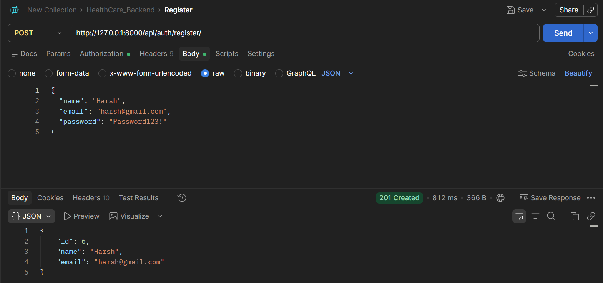
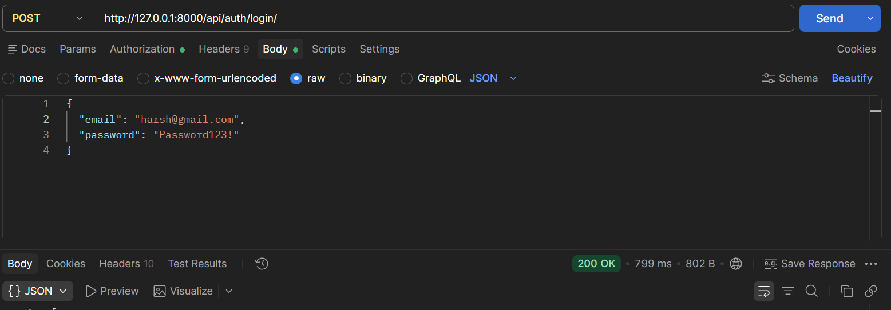
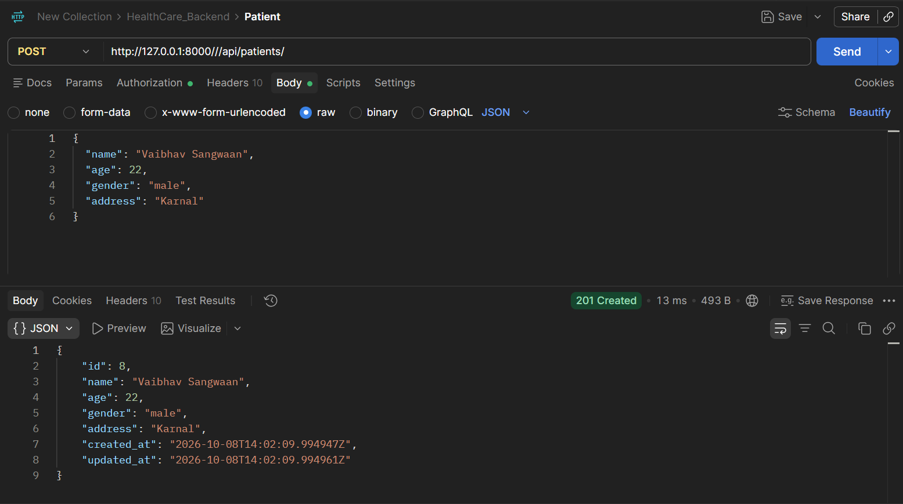
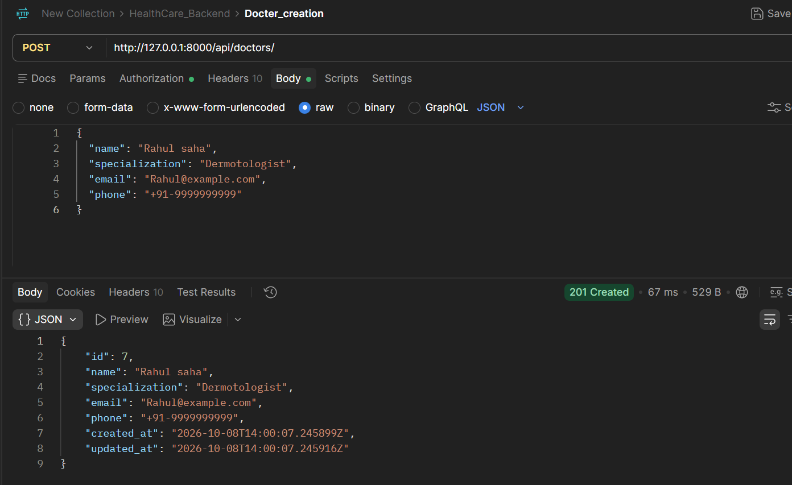
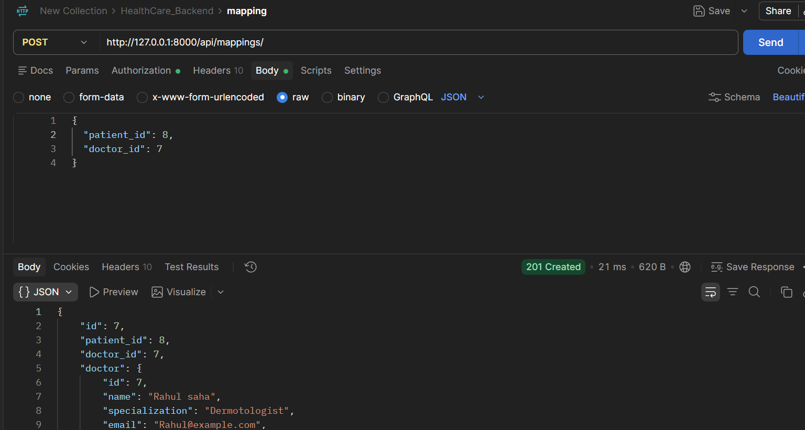

# Healthcare Backend API

Django REST Framework API for user registration, JWT login, patient and doctor records, and patient-doctor assignments. It uses PostgreSQL through Django ORM and loads secrets and database settings from environment variables.

## Setup

1. Create and activate a virtual environment: `py -m venv .venv` followed by `.venv\Scripts\Activate.ps1`.
2. Install dependencies: `py -m pip install -r requirements.txt`.
3. Create a PostgreSQL database, copy `.env.example` to `.env`, and set a private `SECRET_KEY` and the database connection values.
4. Apply migrations: `py manage.py migrate`.
5. Start the API: `py manage.py runserver`.

## API

- `POST /api/auth/register/`: `{ "name": "Asha Rao", "email": "asha@example.com", "password": "a-strong-password" }`
- `POST /api/auth/login/`: `{ "email": "asha@example.com", "password": "a-strong-password" }`; returns `access` and `refresh` JWTs.
- `POST /api/auth/token/refresh/`: refresh an access token.
- Patient CRUD: `/api/patients/` and `/api/patients/{id}/`.
- Doctor CRUD: `/api/doctors/` and `/api/doctors/{id}/`.
- Patient-doctor mappings: `POST /api/mappings/` with `patient_id` and `doctor_id`; list all owned-patient mappings at `/api/mappings/`; list a patient's doctors at `/api/mappings/{patient_id}/`; remove by mapping id with `DELETE /api/mappings/{id}/`.

Send authenticated requests with `Authorization: Bearer <access-token>`. Patient records and mappings are scoped to the authenticated user. Doctors are visible to authenticated users, while only their creator can update or delete them. Duplicate assignments are prevented by a database uniqueness constraint.

## Example request bodies

Patient:

```json
{
  "name": "Riya Shah",
  "age": 32,
  "gender": "female",
  "address": "New Delhi"
}
```

Doctor:

```json
{
  "name": "Arun Mehta",
  "specialization": "Cardiology",
  "email": "arun@example.com",
  "phone": "+91-9999999999"
}
```

Mapping (use IDs returned by creating the patient and doctor):

```json
{
  "patient_id": 1,
  "doctor_id": 1
}
```

## Windows setup

Run the following commands from the directory containing `manage.py`:

```powershell
python -m venv .venv
.venv\Scripts\Activate.ps1
pip install -r requirements.txt
Copy-Item .env.example .env
```

Edit `.env` to match your PostgreSQL database name, username, password, host, and port. Generate a Django secret key with:

```powershell
python -c "import secrets; print(secrets.token_urlsafe(64))"
```

Paste the generated value into `SECRET_KEY` in `.env`. Keep `.env` private and do not submit it. Create the PostgreSQL database, then run:

```powershell
python manage.py migrate
python manage.py runserver
```

The local API base URL is `http://127.0.0.1:8000`. If virtual-environment activation is blocked, run commands with `.venv\Scripts\python.exe` directly.

## Authentication and endpoint details

Registration and login are public. All patient, doctor, and mapping endpoints require a valid JWT access token. In Postman choose **Authorization → Bearer Token** and paste the `access` token returned by login. Use `Content-Type: application/json` for JSON request bodies. Access tokens expire; `POST /api/auth/token/refresh/` accepts `{ "refresh": "<refresh-token>" }` and returns a new access token.

| Method | Endpoint | Purpose |
| --- | --- | --- |
| POST | `/api/auth/register/` | Create an account |
| POST | `/api/auth/login/` | Obtain access and refresh tokens |
| POST | `/api/auth/token/refresh/` | Refresh the access token |
| POST, GET | `/api/patients/` | Create a patient; list your patients |
| GET, PUT, DELETE | `/api/patients/{id}/` | Retrieve, replace, or delete your patient |
| POST, GET | `/api/doctors/` | Create a doctor; list doctors |
| GET, PUT, DELETE | `/api/doctors/{id}/` | Retrieve, update, or delete a doctor (only creator may update/delete) |
| POST, GET | `/api/mappings/` | Assign a doctor; list your patient assignments |
| GET | `/api/mappings/{patient_id}/` | List doctors assigned to a patient |
| DELETE | `/api/mappings/{mapping_id}/` | Remove an assignment by mapping ID |

Patients and mappings are scoped to the authenticated user. Doctors can be read by authenticated users, but only their creator can update or delete them. Duplicate patient-doctor assignments are rejected.

## Postman evaluation walkthrough

1. Start PostgreSQL and the Django server.
2. Register a new user, then log in and copy the response's `access` token. Use it as the Bearer token for the protected requests.
3. Create a patient and a doctor. Save their returned IDs, then list and retrieve each record. Update each with `PUT` and verify the returned values changed.
4. Create a mapping using the patient and doctor IDs. Check it with `GET /api/mappings/` and `GET /api/mappings/{patient_id}/`; remove it with `DELETE /api/mappings/{mapping_id}/`.
5. Delete the patient and doctor. Also check that protected endpoints reject requests without a token (`401`), users cannot retrieve another user's patient, and invalid or duplicate data produces a validation response (`400`).

## Postman screenshots

The following screenshots show the API workflow in Postman:

### User registration



### User login



### Patient creation



### Doctor creation



### Patient-doctor mapping


